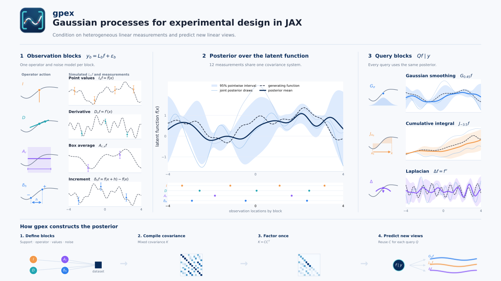

<div align="center">


# gpex

**Gaussian processes for experimental design in JAX.**

[](https://github.com/avrohr/gpex/actions/workflows/ci.yml)
[](https://github.com/avrohr/gpex/actions/workflows/docs.yml)
[](https://github.com/avrohr/gpex/blob/main/LICENSE)

[Documentation](https://avrohr.github.io/gpex/) ·
[Examples](examples/) ·
[Benchmarks](https://avrohr.github.io/gpex/stable/benchmarks/)

</div>



gpex is a Gaussian-process library for experimental design and Bayesian
optimization in JAX. Model a scalar function from noisy values, gradients,
local averages, or other linear measurements, then predict the quantities
needed for your next experiment. For example, infer gradients from function
values or reconstruct a function from local averages.

- **Streaming inference:** reserve capacity, reuse compiled functions, and
  update the posterior as observations arrive.
- **Differentiable queries:** differentiate posterior predictions with respect
  to query locations and operator parameters to build your own design criteria.
- **Hyperparameter fitting:** fit explicit trainable parameters by maximum
  likelihood (MLE) or maximum a posteriori (MAP) estimation.

The first version provides exact dense inference powered by cholops. You choose
the acquisition strategy and experiment loop.

> **Status:** gpex is alpha software. Its public API may change before a
> stable release.

## Installation

gpex requires **Python 3.12 or newer** and **JAX 0.11.2**.

Install the released package from PyPI:

```bash
pip install gpex
```

Or install the latest development version from GitHub:

```bash
pip install "git+https://github.com/avrohr/gpex.git@main"
```

To run the tutorials locally, install
[`uv`](https://docs.astral.sh/uv/getting-started/installation/), then clone the
repository and install the optional notebook dependencies:

```bash
git clone https://github.com/avrohr/gpex.git
cd gpex
uv sync --extra examples
uv run jupyter lab docs/tutorials/first-posterior.ipynb
```

JAX selects the CPU backend by default. Follow the
[JAX installation guide](https://docs.jax.dev/en/latest/installation.html) when
you need a platform-specific accelerator build.

## Predict values and gradients

Suppose you have three noisy measurements of a function and want to know both
its value and its slope between those measurements. Condition a GP on the
observations, then ask for values and gradients together:

```python
import jax
import jax.numpy as jnp

jax.config.update("jax_enable_x64", True)

import gpex as gpx

observations = gpx.FunctionalDataset([
    gpx.ObservationBlock.from_arrays(
        points=jnp.array([[-1.0], [0.0], [1.0]]),
        y=jnp.array([-0.8, 0.0, 0.8]),
        variance=0.01,
        name="values",
        max_size=32,
    )
])
gp = gpx.GaussianProcess(gpx.kernels.RBFKernel(variance=1.0, lengthscale=0.7))
posterior = gp.condition(observations)

x = jnp.linspace(-1.5, 1.5, 101)[:, None]
query = gpx.FunctionalQuery([
    gpx.FunctionalBlock(x, gpx.operators.Identity(), "value"),
    gpx.FunctionalBlock(x, gpx.operators.Gradient(), "gradient"),
])
prediction = posterior.predict_marginals(query)

value_mean = prediction.mean["value"]
gradient_mean = prediction.mean["gradient"]
value_variance = prediction.variance["value"]
```

Each named block describes a quantity to observe or predict. Here `variance` is
the observation noise variance, and `max_size=32` leaves room for later readings.
We recommend enabling float64 before importing gpex and constructing arrays.
Float32 is also supported, but mixed floating dtypes are unsupported.

The [getting-started guide](https://avrohr.github.io/gpex/stable/getting-started/) explains shapes and results.
Built-in operators also cover integrals, averages, Laplacians, and wavelets.
You can [implement your own operator](https://avrohr.github.io/gpex/stable/tutorials/custom-operators/).
[Kernel smoothness](https://avrohr.github.io/gpex/stable/api/kernels/) determines which derivatives
are supported.

The following examples build on the model and observations above.

## Stream observations with fixed capacity

Sequential experiments add observations one at a time. Reserving capacity keeps
array shapes fixed, so compiled functions can be reused as the dataset grows.
Appending also updates the existing Cholesky factor and solved coefficients:

```python
import equinox as eqx
from gpex.blocks import Locations

condition = eqx.filter_jit(gp.condition)
streamed_posterior = condition(observations)

@eqx.filter_jit
def update(posterior, points, values):
    return posterior.append(Locations(points), values, block="values")

streamed_posterior = update(
    streamed_posterior, jnp.array([[0.5]]), jnp.array([0.45])
)
streamed_posterior = update(
    streamed_posterior, jnp.array([[0.75]]), jnp.array([0.65])
)
```

The first call compiles each function. Further updates with the same batch
shape and block reuse the compiled update within the reserved capacity.
Model parameters and noise stay fixed during the sequence. After fitting new
hyperparameters, recondition on the complete dataset.

Choose capacity for the planned experiment: unused slots still cost memory and
computation. See [streaming inference](https://avrohr.github.io/gpex/stable/tutorials/sequential-streaming/),
[reusable conditioning](https://avrohr.github.io/gpex/stable/concepts/jax-and-capacity/), and the
[benchmarks](https://avrohr.github.io/gpex/stable/benchmarks/).

## Differentiate queries for experimental design

Suppose you want to learn the gradient at a fixed point, but can only measure
function values. Prepare that gradient target once, then move a proposed
measurement to minimize the gradient variance that would remain afterward:

```python
target = gpx.FunctionalQuery([
    gpx.FunctionalBlock(jnp.array([[0.25]]), gpx.operators.Gradient(), "gradient"),
])
prepared = gpx.PreparedQuery(posterior.conditioning, target)

def remaining_variance(point, prepared):
    experiment = gpx.ObservationDesignBlock(
        gpx.FunctionalBlock(point[None, :], gpx.operators.Identity(), "candidate"),
        variance=0.01,
        max_size=1,
    )
    return prepared.predict_variance_after(experiment)["gradient"].sum()

value_and_grad = eqx.filter_jit(jax.value_and_grad(remaining_variance))
point = jnp.array([0.5])
for _ in range(50):
    variance, spatial_gradient = value_and_grad(point, prepared)
    point = point - 0.05 * spatial_gradient

print("Proposed measurement location:", point)
```

This is a local gradient-descent search: lower remaining variance means greater
uncertainty reduction at the fixed target. No measurement outcome is needed to
evaluate a proposal. `PreparedQuery` caches the target calculations across
proposals. After collecting a reading and updating the posterior, prepare the
target again. See [experimental design](https://avrohr.github.io/gpex/stable/tutorials/design-of-experiments/)
and the [Bayesian optimization example](https://github.com/avrohr/gpex/blob/main/examples/bayesian-optimization.ipynb)
for complete workflows.

## Fit hyperparameters with MLE or MAP

Mark the quantities to learn with `Parameter` objects. Priors are declared
alongside their parameters. Here we learn the kernel lengthscale while keeping
the kernel variance and observation noise fixed:

```python
from gpex import fitting, parameters, priors

trainable_gp = gpx.GaussianProcess(gpx.kernels.RBFKernel(
    variance=1.0,
    lengthscale=parameters.PositiveParameter(
        0.7,
        prior=priors.LogNormalPrior(log_mean=0.0, log_standard_deviation=0.5),
        name="lengthscale",
    ),
))
mle = fitting.fit_lbfgs(
    trainable_gp,
    lambda model: fitting.negative_log_marginal_likelihood(model, observations),
)
map_fit = fitting.fit_lbfgs(
    trainable_gp,
    lambda model: fitting.negative_log_posterior(model, observations),
)
fitted_posterior = map_fit.model.condition(observations)
print(mle.converged, map_fit.converged)
```

MLE uses the likelihood alone. MAP includes priors and requires one for every
trainable parameter. Inspect convergence before using a fit. For Optax
optimizers, multiple starts, and trainable observation noise, see
[fitting reference](https://avrohr.github.io/gpex/stable/api/fitting/).

## Learn more

- [Tutorial notebooks](https://avrohr.github.io/gpex/stable/tutorials/): mixed measurements, experimental
  design, sequential observations, fitting, and posterior paths.
- [Examples](examples/): additional fitting and compiled-inference workflows,
  plus a Bayesian optimization application.
- [API reference](https://avrohr.github.io/gpex/stable/api/inference/): public classes and operations.
- [JAX and observation capacity](https://avrohr.github.io/gpex/stable/concepts/jax-and-capacity/): compilation reuse,
  sequential updates, and memory costs.

Dense inference targets moderate observation counts. Nonlocal operators use
numerical quadrature, and generic tensor-product rules become expensive as
input dimension grows. See the [operator overview](https://avrohr.github.io/gpex/stable/concepts/linear-operators/)
for supported rules and limits.

## Development and citation

See [CONTRIBUTING.md](CONTRIBUTING.md) for development checks and release
procedures. If you use gpex in your research, please consider citing the software metadata
in [CITATION.cff](CITATION.cff).

gpex is available under the [MIT license](LICENSE).
