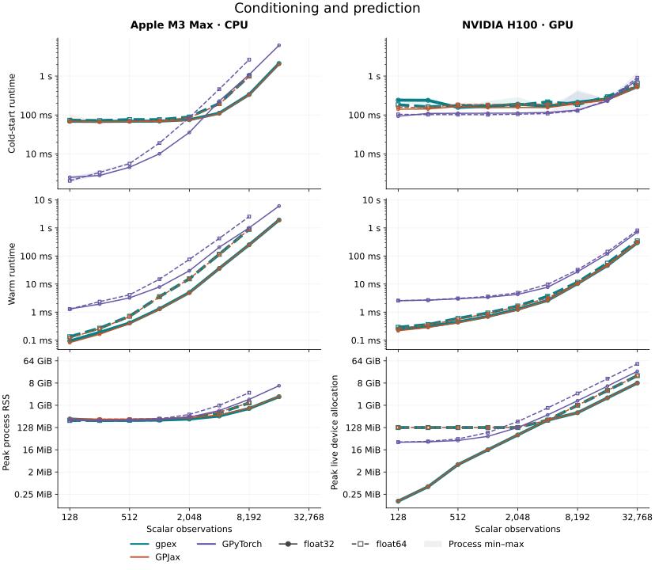
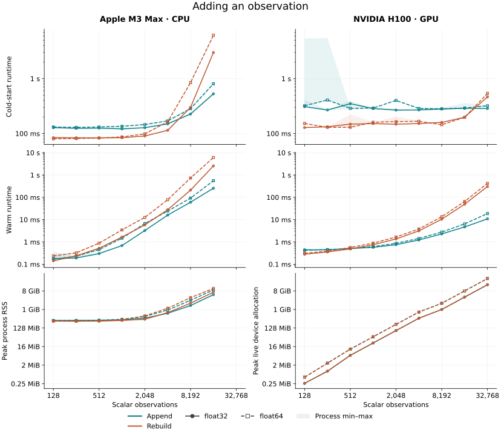
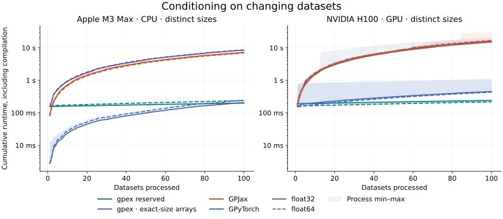
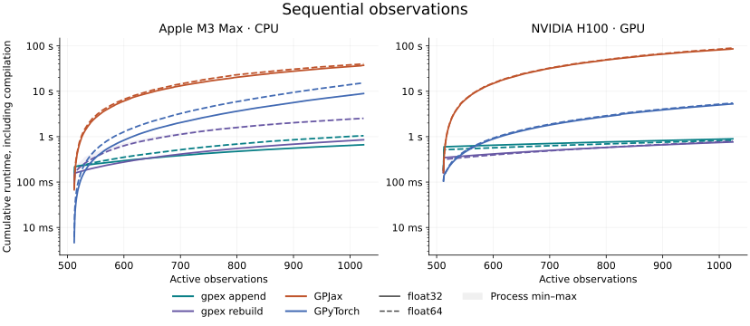
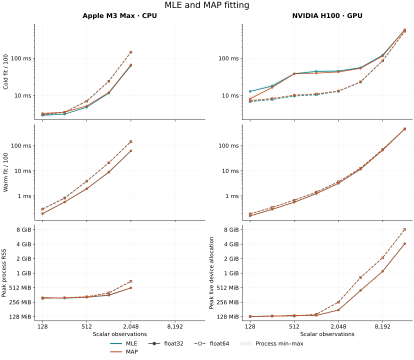
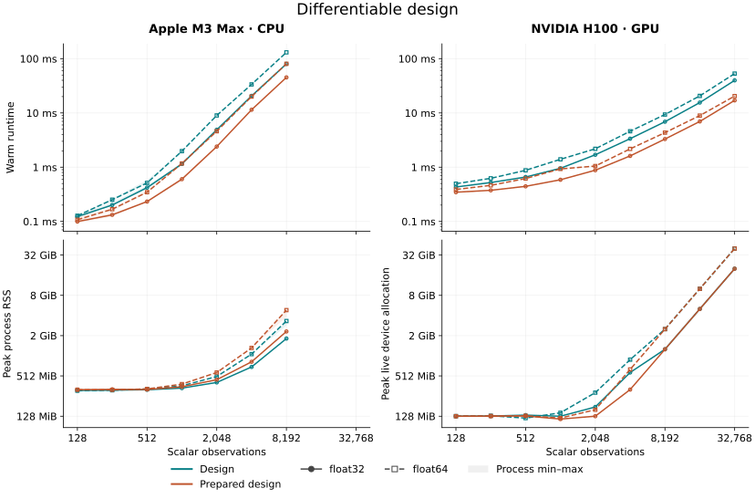
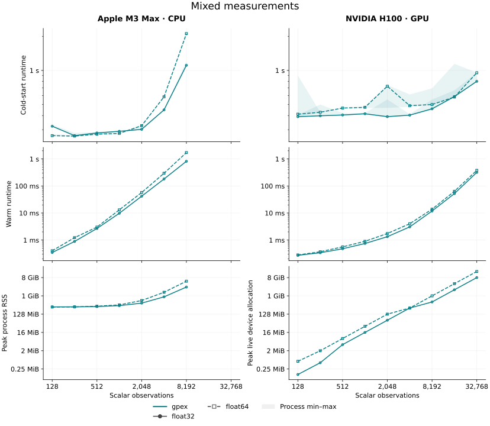
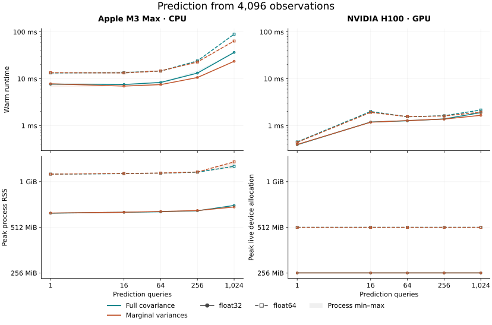

# Performance

These benchmarks measure conditioning, posterior updates, fitting and prediction
on an Apple M3 Max CPU and an NVIDIA H100 GPU. We first measure individual
operations, then follow changing datasets and sequential observations to include
the cost of compilation over a complete workflow.

There are two useful timings:

- **Cold start:** tracing, compilation and the first execution.
- **Warm runtime:** execution after compilation. New data can use the same
  compiled function when array shapes, dtypes and static configuration stay the same.

Neither includes Python startup or input construction. CPU and GPU results appear
side by side. Colors identify methods, solid lines show float32 and dashed lines
show float64. Light bands show the range across three independent processes.
Quoted examples use the recommended float64 precision. Curves stop at sizes
chosen to keep runtime and memory use practical.

## Conditioning and prediction

Start with N function-value observations and predict the mean and covariance at
one point. This measures covariance construction, dense factorization and prediction
together.



```python
result = gp.condition(dataset).predict(query)
```

At N = 32,768 on the H100, warm runtime is **345 ms** for gpex, **325 ms** for
GPJax and **827 ms** for GPyTorch. Peak device allocation is about 16, 16 and 48 GiB.

## Adding an observation

Once a posterior is available, adding an observation need not repeat the full
factorization. Append updates the existing Cholesky factor. Rebuild conditions
from scratch on the complete dataset. Both paths then predict at one point.
The initial posterior is prepared outside timing.



```python
result = posterior.append(Locations(points), values, block="values").predict(query)
result = gp.condition(complete).predict(query)  # rebuild
```

The warm-runtime row shows the cheaper factor update, while the cold-start row
shows how much compilation adds to the first call.
Each point uses storage for N+1 observations and measures one addition. To see
what happens over many additions, we also need to account for compilation reuse.

## Conditioning on changing datasets

With compact datasets, growing the arrays changes their shapes and can trigger
another JAX compilation. gpex's [fixed-capacity observation blocks](concepts/jax-and-capacity.md)
reserve storage and track the number of active observations. Unused slots do not
affect the posterior. Keeping the same block structure, capacities, dtypes and
query shapes lets successive datasets reuse the compiled conditioning function.

This benchmark isolates that benefit: every call builds a new posterior from
scratch. Extra capacity costs memory and computation because the factorization
covers the reserved system. It can still save time when it avoids compilation
for each new dataset size.



```python
condition_and_predict = eqx.filter_jit(
    lambda gp, dataset, query: gp.condition(dataset).predict(query)
)
for dataset in datasets:
    result = condition_and_predict(gp, dataset, query)
    jax.block_until_ready(result)
```

Each curve processes 100 independent datasets with 16–512 observations and
predicts one value after each conditioning call. Every dataset size is distinct.
Reserved gpex datasets keep capacity 512. “gpex · exact-size arrays” sets capacity to the actual number of
observations. GPJax and GPyTorch also use arrays of that length. Cumulative time
includes compilation and excludes input construction and validation.

## Sequential observations

Now keep the observations collected so far and add one at a time. Fixed capacity
reuses compilation, while [posterior append](tutorials/sequential-streaming.ipynb) also reuses
the factor. Comparing append with reconditioning shows the additional benefit
of the factor update once compilation can be reused by both methods.



```python
@eqx.filter_jit
def append_and_predict(posterior, points, values, query):
    posterior = posterior.append(Locations(points), values, block="values0")
    return posterior, posterior.predict(query)
```

Starting from 512 observations, add one observation and predict one value at
each step until there are 1,024 observations. Both gpex methods reserve capacity
1,024. Append updates the factor, while rebuild conditions again on the updated
dataset. GPJax reconditions on growing arrays. GPyTorch uses its incremental
fantasy-update API. Totals include initial conditioning, every prediction and
compilation.

In float64, the complete gpex append workflow takes **1.18 s on CPU** and
**0.85 s on the H100**. Reconditioning takes **2.59 s** and **0.82 s** respectively.
At these sizes, GPU append and reconditioning have similar total cost.

## MLE and MAP fitting

Fitting changes the kernel parameters, so each objective evaluation must account
for a different covariance matrix. Here we optimize variance and lengthscale for
100 Adam steps with fixed observation noise. MAP also includes Gamma priors.



```python
fitted = fit((gp, dataset), objective, optax.adam(0.02), step_count=100)
```

`objective` evaluates `negative_log_marginal_likelihood(*model)` for MLE or
`negative_log_posterior(*model)` for MAP. Both timing rows show complete
100-step fit time divided by 100. Cold time includes compilation, amortized
across those 100 steps. Warm time excludes it. At N = 16,384 in float64 on
the H100, warm MLE takes **457 ms** per average step and MAP **451 ms**.

## Differentiable design

Experimental design compares proposed measurements before their outcomes are
known. We evaluate the remaining gradient variance at the origin after four
proposed value measurements, then differentiate it with respect to their eight
coordinates. Ordinary design appends the proposal to the conditioning state.
Prepared design caches the fixed target query and evaluates its variance reduction
directly. Initial conditioning and query preparation are outside timing.



```python
jax.value_and_grad(design)(points, conditioning, query)
jax.value_and_grad(design_prepared)(points, prepared, variance)
```

At N = 32,768 on the H100, warm objective-and-gradient evaluation takes
**53.1 ms** for ordinary design and **20.4 ms** for prepared design.

## Mixed measurements

The same conditioning operation can combine values, derivatives and averages.
Here the dataset contains approximately equal numbers of function values,
first derivatives and box averages with half-width 0.15. N counts scalar
measurements across all three types.



```python
result = gp.condition(dataset).predict(query)
```

Each call conditions on the complete dataset and predicts one value. Warm
runtime is **379 ms** for N = 32,768 on the H100 and **1.72 s** for N = 8,192
on the CPU.

## Prediction batches

Keep the posterior fixed and vary the number of query points. Full
prediction returns the joint query covariance. Marginal prediction returns
individual variances without constructing that full matrix. Conditioning on
4,096 observations happens before timing.



```python
result = posterior.predict(query)            # mean and full covariance
result = posterior.predict_marginals(query)  # mean and marginal variances
```

On the H100, one query takes **0.44 ms** with either method. At 1,024 queries,
warm runtime is **2.11 ms** for full covariance and **1.93 ms** for marginal
variances. Memory includes the posterior.

<span id="measurement-protocol"></span>

## Hardware and timing

| Setting | Configuration |
| --- | --- |
| CPU | Apple M3 Max, 14 cores, 36 GiB unified memory |
| GPU | NVIDIA H100, approximately 93 GiB device memory, 32 allocated host cores |
| Python | 3.12.11 on CPU, 3.12.13 on GPU |
| Software | JAX/jaxlib 0.11.2, GPJax 1.0.0, PyTorch 2.14.0, GPyTorch 1.15.2 |
| Model | Zero-mean RBF GP, variance 1, lengthscale 0.8, noise variance 0.05 |
| Arithmetic | Separate float32 and float64 runs, highest matrix-multiplication precision |

Regression uses evenly spaced inputs on [-4, 4] and values from
`sin(1.7*x) + 0.1*cos(3.1*x)`. Kernels, input dimensions, observation geometry,
noise and prediction batch size can all change the cost.

The single-operation plots show cold and warm timing separately where indicated.
Append and rebuild also show both timings. Design and prediction plots show
warm execution from prepared state.

Each ordinary point is the median of three independent process medians. Each
process measures 20 synchronized warm calls, five complete fits, or two updates,
depending on the workload. Cold timing uses one first call per process. Light
bands show the process min–max range, not a confidence interval. Complete
workflows have three process samples and include compilation in their cumulative
timings. GPyTorch runs eagerly, so its cold time is the first execution without
a separate compilation phase.

CPU runs use library-default threading. The
[benchmark harness](https://github.com/avrohr/gpex/blob/6a14d6375bdb253de5e470dcd08aed2688ef3333/benchmarks/workloads.py)
synchronizes JAX results and runs numerical checks outside timing. Single-operation
conditioning uses exact capacity. Append reserves one additional observation,
and ordinary design reserves the four proposed observations.

Memory is the largest recorded peak across the three processes. CPU memory is
peak process RSS, including setup and compilation. GPU memory is peak live
device allocation, excluding host memory and unused pool capacity. Both use
the same scale across precisions within a figure.

Training jitter is 1e-6 in gpex and GPJax. GPJax also uses predictive jitter
of 1e-6.

GPU runs use CUDA 13 with NVIDIA driver 595.91.07 or 615.71.09, depending on the
allocated node. The host CPU is an AMD EPYC 9554. Driver and node differences
can affect compilation and runtime, so small differences between methods should
not be interpreted as controlled comparisons on identical systems. Every worker
disables `xla_gpu_experimental_enable_fusion_autotuner`
to avoid expensive fusion candidate compilation.
GPJax is pinned to commit `964bad77483e3c694f116d666d21617a1260208b`.

<span id="reproduce-the-campaign"></span>

## Reproduce the measurements

Install the locked comparison dependencies and profile a smaller grid locally:

```bash
uv sync --locked --all-groups
XLA_FLAGS=--xla_gpu_experimental_enable_fusion_autotuner=false \
JAX_DEFAULT_MATMUL_PRECISION=highest \
uv run --frozen --group comparison python benchmarks/run.py \
  --workloads dense gpjax gpytorch --sizes 256 1024 4096 \
  --dtype float64 --process-samples 3 --repeats 20 \
  --output results/local.json
uv run --frozen python benchmarks/plot.py --results results/local.json \
  --output-dir results/figures
```

Repeat with `--dtype float32` and a separate output path for single precision.
The [benchmark runner documentation](https://github.com/avrohr/gpex/blob/main/benchmarks/README.md)
describes workloads, settings, numerical checks and report fields.

These figures measure source `6a14d6375bdb253de5e470dcd08aed2688ef3333`.
The `profiling` branch contains the campaign plan, plot generator and compact
measurements in `profiling/results/6a14d63.json`.
One float64 MLE process at N = 16,384 was rerun after a non-finite result. The
retry passed on the same node with unchanged source and numerical settings and
is included with the two original successful processes.
