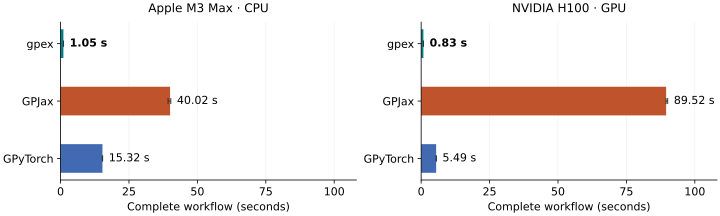

---
hide:
  - toc
---

# gpex

**Gaussian processes for experimental design in JAX.**

gpex is a JAX library for Gaussian-process inference from values,
derivatives, and other linear measurements. Combine
different measurement types in one model, then predict the quantities you
care about from the same posterior.

It is built for experimental design and Bayesian optimization involving a
scalar latent function. gpex provides the posterior operations; you choose
the acquisition strategy and experiment loop.

[Get started](getting-started.md){ .md-button .md-button--primary }
[Tutorials](tutorials/index.md){ .md-button }
[API reference](api/inference.md){ .md-button }

!!! note "Alpha status"
    The mathematical model and core inference paths are implemented and tested.
    The package is still pre-1.0, so public names may change before the first
    stable release.

## Key features

<div class="gpex-features" markdown>

<div markdown>
<svg class="gpex-feature-icon" viewBox="0 0 72 56" aria-hidden="true" focusable="false">
  <path d="M12 7H7v42h5m38-42h5v42h-5"/>
  <g class="gpex-icon-solid">
    <rect x="14" y="11" width="6" height="6" rx="1"/>
    <rect x="14" y="21" width="6" height="6" rx="1"/>
    <rect x="24" y="21" width="6" height="6" rx="1"/>
    <rect x="14" y="31" width="6" height="6" rx="1"/>
    <rect x="24" y="31" width="6" height="6" rx="1"/>
    <rect x="34" y="31" width="6" height="6" rx="1"/>
  </g>
  <g class="gpex-icon-accent">
    <rect class="gpex-icon-wash" x="11" y="39" width="42" height="12" rx="3"/>
    <g class="gpex-icon-solid">
      <rect x="14" y="41" width="6" height="6" rx="1"/>
      <rect x="24" y="41" width="6" height="6" rx="1"/>
      <rect x="34" y="41" width="6" height="6" rx="1"/>
      <rect x="44" y="41" width="6" height="6" rx="1"/>
    </g>
    <path d="M59 20h10m-5-5v10"/>
  </g>
</svg>

### Efficient sequential updates

Update your GP as new observations arrive, reusing previous computations and
reducing JAX compilation overhead.

[Explore streaming inference →](tutorials/sequential-streaming.ipynb)

</div>

<div markdown>
<svg class="gpex-feature-icon" viewBox="0 0 72 56" aria-hidden="true" focusable="false">
  <rect class="gpex-icon-accent gpex-icon-wash" x="49" y="10" width="16" height="36" rx="3"/>
  <path d="M5 39c6 0 8-23 18-23s12 24 22 24 11-29 22-29"/>
  <g class="gpex-icon-accent">
    <circle class="gpex-icon-point" cx="12.5" cy="27.5" r="3.5"/>
    <path d="m27 14 14 28m8-14h16m-16-4v8m16-8v8"/>
    <circle class="gpex-icon-solid" cx="34" cy="28" r="2"/>
  </g>
</svg>

### Linear operators

Combine linear measurements in one GP and use it to predict linear transformations of the latent function.

[Explore gpex linear operator support →](tutorials/mixed-measurements.ipynb)

</div>

<div markdown>
<svg class="gpex-feature-icon" viewBox="0 0 72 56" aria-hidden="true" focusable="false">
  <path class="gpex-icon-guide" d="M6 48h60m-28-4V18"/>
  <path d="M6 41c12 0 13-29 32-29s16 25 28 25"/>
  <g class="gpex-icon-accent">
    <path d="m17 42 16-20m-8 2 8-2v8"/>
    <circle class="gpex-icon-point" cx="38" cy="12" r="3.5"/>
  </g>
</svg>

### Differentiable design

Fully differentiable conditioning for gradient-based optimization of experimental design.

[Design an experiment →](tutorials/design-of-experiments.ipynb)

</div>

</div>

## Adding observations to an existing posterior

In JAX, growing a Cholesky factor changes array shapes and can trigger
recompilation, even when the update itself is efficient. gpex combines Cholesky
updates with reserved capacity so fixed-size observation batches can reuse
compiled code.

Start with 512 observations, then add 512 more and predict after every update.
gpex completes this workflow **38× faster than GPJax and 15× faster than
GPyTorch on CPU**, and **108× and 6.6× faster on the H100**.



Float64, fixed hyperparameters, one prediction point per update. Times include
initial conditioning and compilation, with numerical libraries initialized before
timing. Bars show medians of three processes,
with min–max ranges. [Full benchmark and setup](benchmarks.md#sequential-observations).

## View the GP posterior through linear operators

Observe values, slopes, or local averages, and see how each informs all three
predictions.

<div class="gpex-demo" id="gpex-demo">
  <p class="gpex-demo-fallback">Enable JavaScript to explore the interactive example.</p>
  <div class="gpex-demo-content" hidden>
    <div class="gpex-demo-controls">
      <fieldset class="gpex-demo-types">
        <legend>Use measurements</legend>
        <label class="gpex-value"><input type="checkbox" value="value" checked> <span>Values</span></label>
        <label class="gpex-slope"><input type="checkbox" value="slope" checked> <span>Slopes</span></label>
        <label class="gpex-average"><input type="checkbox" value="average" checked> <span>Averages</span></label>
      </fieldset>
    </div>
    <div class="gpex-demo-legend" aria-hidden="true">
      <span><i class="gpex-mean-key"></i>Posterior mean</span>
      <span><i class="gpex-band-key"></i>±2 standard deviations</span>
      <span><i class="gpex-truth-key"></i>Reference</span>
    </div>
    <div class="gpex-demo-views">
      <div>
        <h3>Function</h3>
        <svg class="gpex-demo-plot" data-kind="value" role="img" aria-label="Function prediction and uncertainty"></svg>
      </div>
      <div>
        <h3>Derivative</h3>
        <svg class="gpex-demo-plot" data-kind="slope" role="img" aria-label="Derivative prediction and uncertainty"></svg>
      </div>
      <div>
        <h3>Local average</h3>
        <svg class="gpex-demo-plot" data-kind="average" role="img" aria-label="Local-average prediction and uncertainty"></svg>
      </div>
    </div>
    <svg class="gpex-demo-locations" role="img" aria-labelledby="gpex-location-title gpex-location-description">
      <title id="gpex-location-title">Shared measurement locations</title>
      <desc id="gpex-location-description">Drag markers to move measurements. The controls below also let you add, move, or remove measurements by keyboard.</desc>
    </svg>
    <p class="gpex-demo-hint">Click a plot to take that kind of measurement. Drag a marker below the plots to move one.</p>
    <div class="gpex-demo-editor">
      <label for="gpex-add-kind">New measurement
        <select id="gpex-add-kind">
          <option value="value">Value</option>
          <option value="slope">Slope</option>
          <option value="average">Average</option>
        </select>
      </label>
      <button type="button" id="gpex-add">Add at x = 0</button>
      <button type="button" id="gpex-reset">Reset</button>
    </div>
    <div class="gpex-demo-editor gpex-demo-selection">
      <label for="gpex-selected">Selected measurement <select id="gpex-selected"></select></label>
      <label class="gpex-demo-position" for="gpex-position">Position <output id="gpex-location" for="gpex-position">0.00</output>
        <input id="gpex-position" type="range" min="-3.5" max="3.5" step="0.01" value="0">
      </label>
      <button type="button" id="gpex-remove">Remove</button>
    </div>
    <p class="gpex-demo-status" id="gpex-demo-status" role="status" aria-live="polite"></p>
  </div>
</div>

Measurements come from a fixed example function. Each dashed line shows the
corresponding reference quantity. Averages cover a window of width 0.9. The
shaded bands describe uncertainty in the predicted quantities, excluding
observation noise.
[See the same ideas in Python →](tutorials/mixed-measurements.ipynb)

??? info "About this example"
    This small browser demo uses a zero-mean RBF GP with unit variance and
    lengthscale. Observation noise variances are 0.015 for values, 0.035 for
    slopes, and 0.01 for averages. Averages use an eight-point midpoint rule.
    Measurements are evaluations of the example function without added random
    noise. Moving a marker takes a new measurement at that position.
    The browser implements this fixed example in JavaScript. The gpex library
    runs in Python with JAX.

## Fit a model with values and predict the gradient

Condition on three function values, then predict gradients between those
measurements. `ObservationBlock.from_arrays` creates the observation block
directly from location and value arrays:

```python
import jax
import jax.numpy as jnp

jax.config.update("jax_enable_x64", True)

import gpex as gpx
from gpex.operators import Identity, Gradient

x_obs = jnp.array([[-1.0], [0.0], [1.0]])
y = jnp.array([-0.8, 0.0, 0.8])
observations = gpx.FunctionalDataset([
    gpx.ObservationBlock.from_arrays(x_obs, y, operator=Identity(), variance=0.01, name="values")
])
gp = gpx.GaussianProcess(gpx.kernels.RBFKernel(lengthscale=0.7))
posterior = gp.condition(observations)

x_query = jnp.linspace(-1.0, 1.0, 51)[:, None]
query = gpx.FunctionalQuery([
    gpx.FunctionalBlock(x_query, operator=Gradient(), name="gradient"),
])
gradient_mean = posterior.predict_mean(query)["gradient"]  # shape (51, 1)
```

`variance` is the observation noise variance. The
[getting-started guide](getting-started.md) explains the array shapes and
returned predictions step by step. For the mathematics behind combining
measurement types, see [Gaussian processes with linear functionals](concepts/linear-functionals.md)
and the [available operators](concepts/linear-operators.md).

Kernel and noise parameters can also be learned with
[maximum likelihood (MLE) or maximum a posteriori (MAP) fitting](tutorials/mle-map.ipynb).

## Related libraries

The choice depends on the model and workflow you need:

| Library | Framework | A useful choice when you need… |
| --- | --- | --- |
| **gpex** | JAX | Mixed linear measurements, differentiable design, and sequential inference that reuses compiled code and posterior factors within a fixed capacity. |
| [GPJax](https://docs.jaxgaussianprocesses.com/) | JAX | A range of GP models and likelihoods, including classification and sparse variational inference. |
| [GPyTorch](https://docs.gpytorch.ai/en/stable/) | PyTorch | Scalable exact and variational GP inference, multitask models, or neural-network integration. |
| [BoTorch](https://botorch.org/) | PyTorch | A Bayesian-optimization toolkit with built-in acquisition functions and acquisition optimizers. |

gpex and GPJax both benefit from JAX's compiled execution. For small sequential
experiments, however, compiling for each new dataset size can dominate the
work. gpex's reserved observation blocks let the same compiled conditioning
and update functions serve successive experiment steps. Choose capacity for
the planned experiment, since reserved slots also cost memory and computation.
